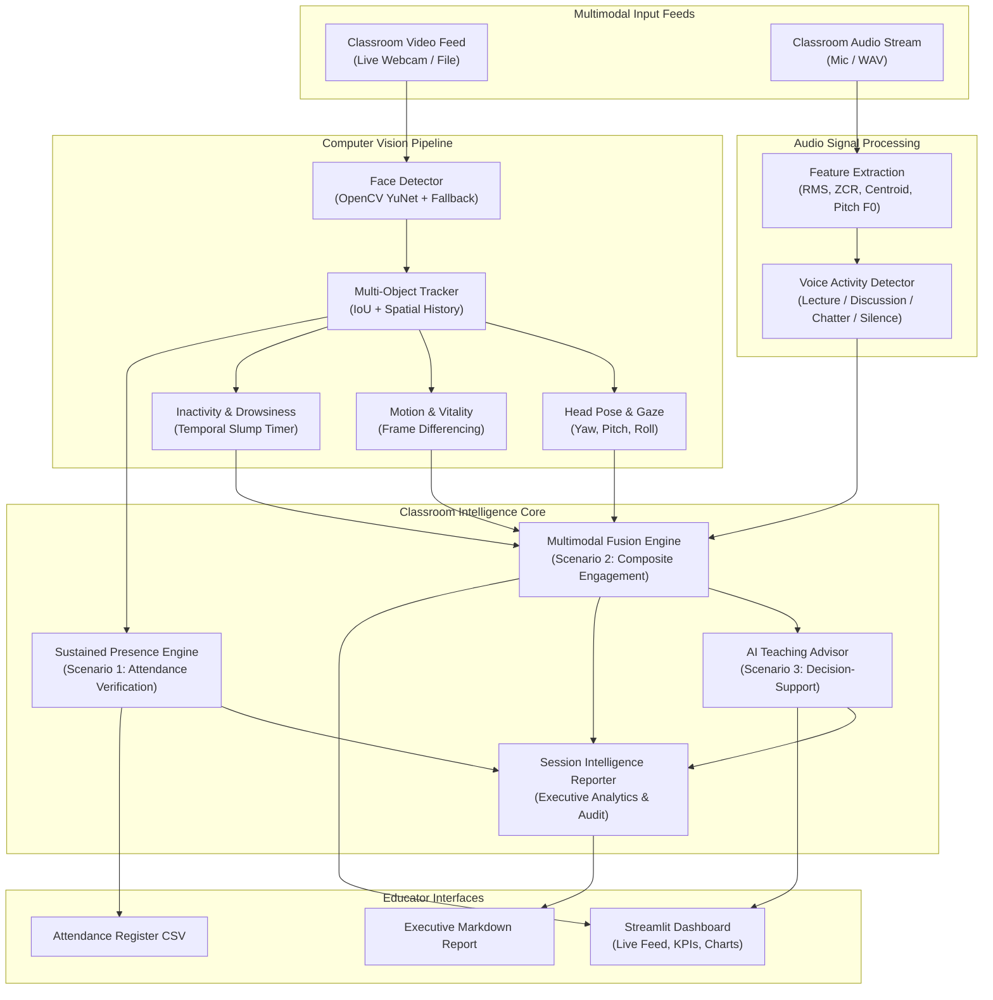

# 🎓 Multimodal Attendance & Engagement Agent

[](https://www.python.org/downloads/)
[](https://opencv.org/)
[](https://streamlit.io/)
[]()
[]()

> **An AI-powered, privacy-preserving classroom intelligence system integrating Computer Vision, Audio Signal Processing, and Agent-Based Reasoning to track attendance via sustained presence, quantify session engagement dynamics, and provide real-time assistive pedagogical decision-support.**

---

## 📌 Problem Context & Vision

Traditional attendance tracking in schools and professional training environments is either **manual** (time-consuming roll calls) or relies on **simplistic biometrics** that capture zero participation context. Furthermore, transient appearances (e.g., someone walking past the camera or stepping in for 5 seconds) trigger false positives in basic face detection counters.

The **Multimodal Attendance & Engagement Agent** moves beyond mere presence detection. It operates **entirely offline** on edge hardware, ensuring strict ethical and student privacy standards. By fusing visual behavioral indicators with classroom acoustic dynamics, the agent empowers educators with real-time, non-intrusive decision-support.

---

## 🌟 Core Scenarios Implemented

### 1. Scenario 1: Automated Attendance Tracking via Sustained Presence
- **Sustained Presence State Machine**: Replaces single-frame detection with continuous temporal verification. A participant must maintain presence for a configurable sustained duration ($T_{\text{sustained}}$, e.g. $\ge 6.0$s) and dwell ratio ($\ge 60\%$) to be confirmed.
- **Passerby & False Positive Filtering**: Transient appearances (passersby walking across camera) are automatically classified as `Transient (Passerby)` and filtered from the official register.
- **Tardy & Early Exit Detection**: Distinguishes between `Present (Verified)`, `Late Arrival` (first detected after cutoff), `Left Early`, and `Transient`.
- **Timestamped Audit Logs**: Automatically generates granular audit event logs with millisecond timestamps and wallclock times. Exportable to **CSV** and **JSON**.

### 2. Scenario 2: Engagement & Session Dynamics Analysis
- **Head Pose & 3D Gaze Estimation**: Computes Yaw ($\theta_y$), Pitch ($\theta_p$), and Roll ($\theta_r$) from facial landmarks. Differentiates `Focused (Front)`, `Looking Down (Note-taking or Device)`, `Looking Left/Right (Distracted)`, and `Head Slumped (Drowsy)`.
- **Motion & Posture Vitality**: Frame-differencing optical energy within participant ROIs categorizes behavior into `Attentive Calm`, `Active (Writing/Nodding)`, `Restless/Fidgeting`, or `Static/Frozen`.
- **Inactivity & Drowsiness Tracking**: Temporal watchdog flags sustained immobility combined with downward slump.
- **Classroom Acoustic Signal Processing**:
  - RMS energy (volume/loudness)
  - Zero-Crossing Rate (ZCR)
  - Spectral Centroid & Spectral Rolloff (frequency distribution)
  - Pitch fundamental frequency ($F_0$) via autocorrelation
  - Voice Activity Detection (VAD) categorizing room into `Teacher Monologue / Lecture`, `Active Student Discussion / Q&A`, `Silent Study`, or `Ambient Chatter / Distraction`.
- **Temporal Event Detection**: Identifies **Attention Drops** ($\bar{E} < 45\%$), **Interaction Peaks** ($\bar{E} \ge 75\%$ + dynamic discussion), and **Pacing Fatigue** (progressive attention decay during lectures).
- **Spatial Quadrant Analytics**: Maps engagement across classroom zones (`Front-Left`, `Front-Right`, `Back-Left`, `Back-Right`) to detect disengagement pockets.

### 3. Scenario 3: AI-Driven Teaching Suggestions
- **Context-Aware Pedagogical Decision Support**: Acts as a non-intrusive co-pilot for educators.
  - *Attention Dips*: Recommends rapid active learning interventions (e.g. 60-second Think-Pair-Share or quick comprehension polls).
  - *Pacing Fatigue*: Suggests pausing a continuous monologue to summarize key takeaways and solicit student questions.
  - *Postural Inactivity / Slump*: Suggests physical posture shifts, stretch breaks, or interactive prompts.
  - *Room Chatter Surge*: Alerts instructor to regroup room attention with a challenge problem.
  - *Flow State Affirmation*: Detects optimal focus (>80%) and advises maintaining pace without disruption.
- **Executive Session Intelligence Report**: Automatically generates an end-of-class Markdown and JSON summary detailing pacing distribution, attendance statistics, engagement curves, and tailored suggestions for the next lecture.

---

## 🏛️ System Architecture



---

## 📐 Mathematical Formulation

### 1. Sustained Presence Verification (Scenario 1)
$$\text{Presence Ratio}_i = \frac{T_{\text{dwell}, i}}{T_{\text{session}}}$$
$$\text{Status}_i = \begin{cases} 
\text{Present (Verified)}, & \text{if } T_{\text{dwell}, i} \ge T_{\min} \text{ and } \text{Presence Ratio}_i \ge 0.60 \text{ and } T_{\text{first}, i} \le T_{\text{tardy}} \\
\text{Late Arrival}, & \text{if } T_{\text{dwell}, i} \ge T_{\min} \text{ and } T_{\text{first}, i} > T_{\text{tardy}} \\
\text{Transient (Passerby)}, & \text{if } T_{\text{dwell}, i} < T_{\min} \text{ and participant has departed}
\end{cases}$$

### 2. Head Pose & Gaze Attention Score (Scenario 2)
From YuNet 5 facial landmarks (right eye, left eye, nose tip, mouth corners):
$$\text{Yaw} = \left(\frac{d_{\text{right}} - d_{\text{left}}}{d_{\text{right}} + d_{\text{left}}}\right) \times 75^\circ, \quad \text{Pitch} = -\left(\frac{y_{\text{nose}} - y_{\text{eye}}}{y_{\text{mouth}} - y_{\text{eye}}} - 0.52\right) \times 85^\circ$$
$$V_{\text{attention}} = \max\left(5.0, 100.0 - \left[25\left(\frac{|\text{Yaw}|}{22^\circ}\right)^{1.8} + 25\left(\frac{\max(0, -\text{Pitch})}{18^\circ}\right)^{2.0}\right]\right)$$

### 3. Multimodal Signal Fusion
Composite engagement $E_i(t)$ for participant $i$ at time $t$:
$$E_i(t) = w_v \cdot V_{\text{attention}, i}(t) + w_m \cdot M_{\text{vitality}, i}(t) + w_a \cdot A_{\text{participation}}(t) - P_{\text{inactivity}, i}(t)$$
$$\bar{E}(t) = \frac{1}{N} \sum_{i=1}^N E_i(t)$$
*Default normalized weights: $w_v = 0.50$, $w_m = 0.25$, $w_a = 0.25$.*

---

## 📂 Repository Structure

```
multimodal-attendance-agent/
├── app.py                     # Streamlit interactive classroom dashboard
├── run_headless.py            # CLI batch runner for automated headless processing
├── config.py                  # System thresholds, weights, and configurations
├── demo_generator.py          # Synthetic multimodal classroom video & audio generator
├── core/
│   ├── tracker.py             # Spatial-temporal participant tracker with IoU matching
│   └── presence.py            # Sustained presence state machine & attendance logs (Scenario 1)
├── vision/
│   ├── face_detector.py       # OpenCV YuNet deep neural detector + adaptive fallback
│   ├── pose_estimator.py      # 3D Head pose (Yaw, Pitch, Roll) and visual attention
│   ├── motion_analyzer.py     # Frame-differencing motion vitality & posture state
│   └── drowsiness_detector.py # Inactivity timer & slump detector
├── audio/
│   ├── signal_processor.py    # RMS, ZCR, Spectral Centroid, Rolloff, Pitch (F0)
│   └── vad.py                 # VAD & Acoustic Mode classifier (Lecture, Discussion, Chatter)
├── fusion/
│   └── engagement_engine.py   # Multimodal fusion, attention drops, peaks, quadrants (Scenario 2)
├── agent/
│   ├── teaching_advisor.py    # AI pedagogical reasoning & real-time suggestions (Scenario 3)
│   └── session_analyzer.py    # Executive session intelligence report generator
├── models/
│   └── face_detection_yunet_2023mar.onnx
├── data/                      # Synthetic classroom demo video & synchronized audio
├── exports/                   # Exported attendance CSVs, audit logs, and reports
└── tests/
    └── test_pipeline.py       # Complete unit & integration test suite
```

---

## 🚀 Quickstart Guide

### 1. Environment Setup
```bash
cd /Users/radhayadav/.gemini/antigravity/scratch/multimodal-attendance-agent
source venv/bin/activate
pip install -r requirements.txt
```

### 2. Run the Interactive Web Dashboard
```bash
streamlit run app.py
```
- Open `http://localhost:8501` in your browser.
- Select **Classroom Demo** to test immediately with the 4-student avatar simulation, or choose **Upload Video & Audio** or **Live Webcam**.
- Explore the **Attendance Register**, **Engagement Dynamics**, **AI Teaching Suggestions**, and **Session Report** tabs!

### 3. Run Headless CLI Batch Processing
To process classroom video recordings directly from the terminal and export CSVs and Markdown reports:
```bash
python run_headless.py --video data/sample_classroom.mp4 --audio data/sample_classroom.wav
```
Outputs generated in `exports/`:
- `exports/attendance_register.csv`: Official attendance sheet
- `exports/classroom_report.md`: Executive session analytics
- `exports/annotated_classroom.mp4`: Rendered video with bounding boxes & engagement tags

### 4. Run Automated Test Suite
```bash
python -m unittest tests/test_pipeline.py
```
Verifies Scenario 1 (Sustained Presence), Scenario 2 (Multimodal Dynamics), and Scenario 3 (Teaching Advisor) in under 0.1s!

---

## 🛡️ Privacy & Ethical Deployment

1. **100% Offline Edge Computation**: No audio or video is transmitted to any cloud servers; processing occurs locally on-device.
2. **Face Anonymization Mode**: Real-time Gaussian blurring can be toggled on-device before any rendering, protecting learner identities in compliance with **FERPA** and **GDPR**.
3. **Non-Intrusive Decision Support**: The agent strictly provides assistive suggestions; it does not grade, penalize, or enforce actions upon learners or teachers.
